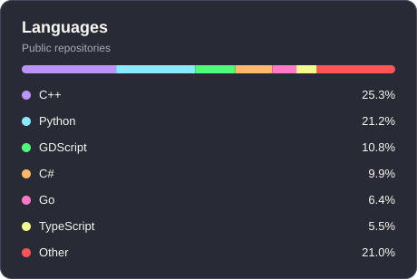
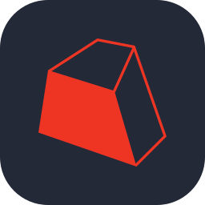

<!-- 
 -->
<!--    -->
<!--    -->
<!--    -->
<!--    -->
<!--    -->
<!-- 
 -->

## About me

MSc. student in Computer Science at the University of Campinas (Unicamp), working at LOCo (Laboratory of Optimization and Combinatorics).
I research combinatorial optimization, mainly scheduling problems through integer linear programming, exact algorithms and heuristics.

Outside of research, I like building software and games. 
<!--   -->

## What I’m Working On

- **Branch and Price** — exploring branch-and-price methods for optimization.
- **gb-emulator** — Game Boy emulator in C++.
- **bon mot.** — a tool for learning French.
- **Games** — jam games and side projects, on [itch.io](https://tururuca.itch.io/).

 

 

## Tech Stack

| Category&nbsp;&nbsp;&nbsp;&nbsp; | Tools |
| --- | :---: |
| **Research & Optimization**&nbsp;&nbsp;&nbsp;&nbsp; |   |
| **Backend**&nbsp;&nbsp;&nbsp;&nbsp; |  |
| **Frontend**&nbsp;&nbsp;&nbsp;&nbsp; |  |
| **Data & Cloud**&nbsp;&nbsp;&nbsp;&nbsp; |  <!--  --> |
| **Game Dev**&nbsp;&nbsp;&nbsp;&nbsp; |  |

 

