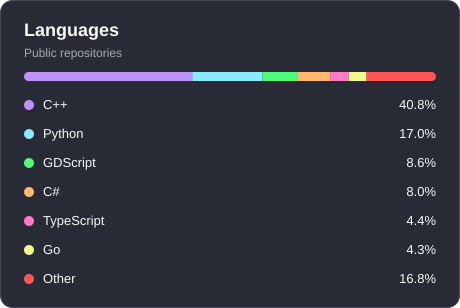

  
  
  
  
  

## About me

- MSc. student in Computer Science @ Unicamp
- BSc. in Computer Science @ UDESC
- Game dev enthusiast

<!--   -->

<!-- ## What I’m Working On

- **Branch and Price** — exploring branch-and-price methods for optimization.
- **Neoswitch** — a Neovim profile switcher.
- **bon mot.** — a tool for learning French. -->

 

## Tech Stack

| Category | Tool |
| --- | :---: |
| **Languages** |  |
| **Backend** |  |
| **Frontend** |  |
| **Databases & Infrastructure** |  |
| **Game Development** |  |

 

